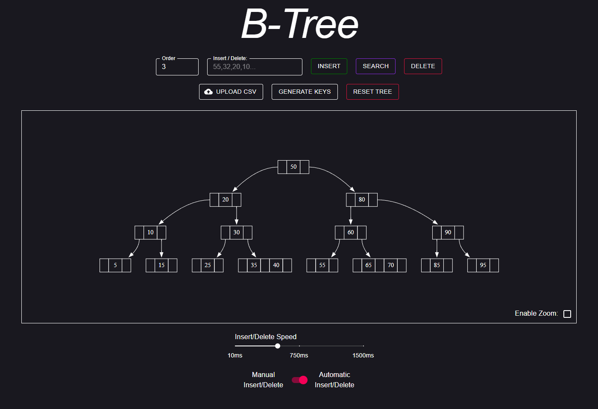

# B-Tree Visualizer

  

An interactive web app that visualizes insertion, deletion and search in a B-tree, step by step.

**Live demo: [btree.lucask.dev](https://btree.lucask.dev)**

## Context

A university project from November and December 2020, written for a data structures course. The B-tree algorithm is implemented from scratch in plain JavaScript; the order definition follows the one taught in the lecture (see [Notes on the algorithm](#notes-on-the-algorithm)).



## Features

- Insert and delete single keys, or many comma-separated keys at once
- Search for a key; the found key is highlighted in the graph
- Automatic insert/delete that shows every intermediate tree
- Adjustable insert/delete speed
- Manual mode with "Back" and "Forward" buttons to step through an insertion
- Changeable tree order
- Random key generation with a configurable minimum, maximum and number of keys
- CSV import of keys
- Graphical rendering of the tree with Graphviz
- Input validation
- Optional zoom

## Tech stack

- [React](https://reactjs.org/) 17, bootstrapped with Create React App (webpack)
- [Material-UI](https://material-ui.com/) v4 for the controls
- [graphviz-react](https://www.npmjs.com/package/graphviz-react), which brings [Graphviz](https://graphviz.org/) rendering to React
- Firebase Hosting, with GitHub Actions workflows for deploys on push to `main` and preview channels on pull requests

## Running locally

Requires [Git](https://git-scm.com/downloads), Node.js and [Yarn](https://classic.yarnpkg.com/en/docs/install/).

```bash
git clone https://github.com/xD33m/btree.git
cd btree
yarn install
yarn start
```

This starts a development server; open [http://localhost:3000](http://localhost:3000).

`yarn build` creates a production build in `build/`. Note that the project uses `react-scripts` 4 from 2020: on Node.js 17 or newer you may need `NODE_OPTIONS=--openssl-legacy-provider`, and the `build` script sets `GENERATE_SOURCEMAP=false` with POSIX shell syntax.

## Architecture

```
src
 ┣ Components
 ┃ ┣ Controls.jsx ------------ Buttons, text fields, sliders
 ┃ ┣ Graph.jsx --------------- Renders the tree graph
 ┃ ┣ Home.jsx ---------------- Main component and app state
 ┃ ┗ RandomNumberDialog.jsx -- Dialog for generating random keys
 ┣ js -------------------------- B-tree algorithm and helpers
 ┃ ┣ BTree.js ---------------- Main B-tree class
 ┃ ┣ BTreeNode.js ------------ Node class (insert, split, delete, rebalance, merge, search)
 ┃ ┗ helpers.js -------------- Helper functions
 ┣ ...
```

### How the tree is drawn

The algorithm produces the tree in a custom JSON structure. That structure is converted by hand into the Graphviz [DOT language](https://graphviz.org/doc/info/lang.html), which Graphviz then lays out and renders.

## Notes on the algorithm

- "Order" is defined differently in different textbooks. This project uses the definition from the lecture: for order `m`,
  - every node has at least  children (so a node holds at least  keys), and
  - a node has at most `m` children.
- Helper libraries such as jQuery were deliberately left out to keep the bundle small.

## Status

Finished in December 2020 and archived. The live demo is still online.
